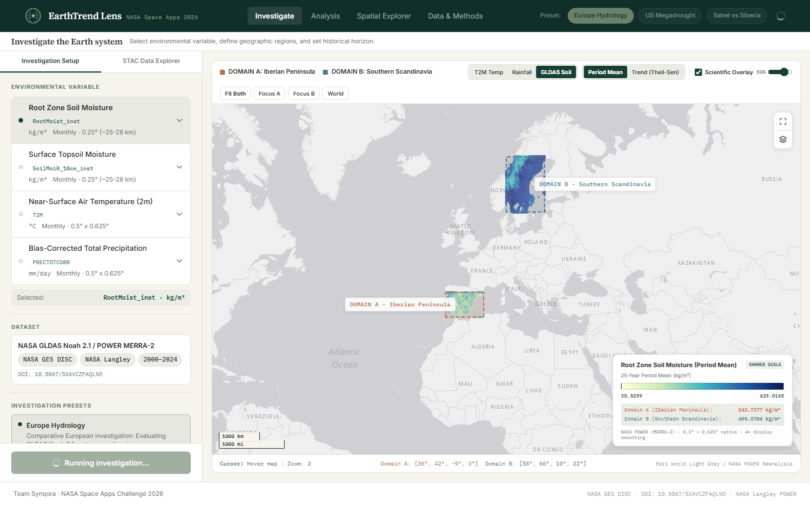
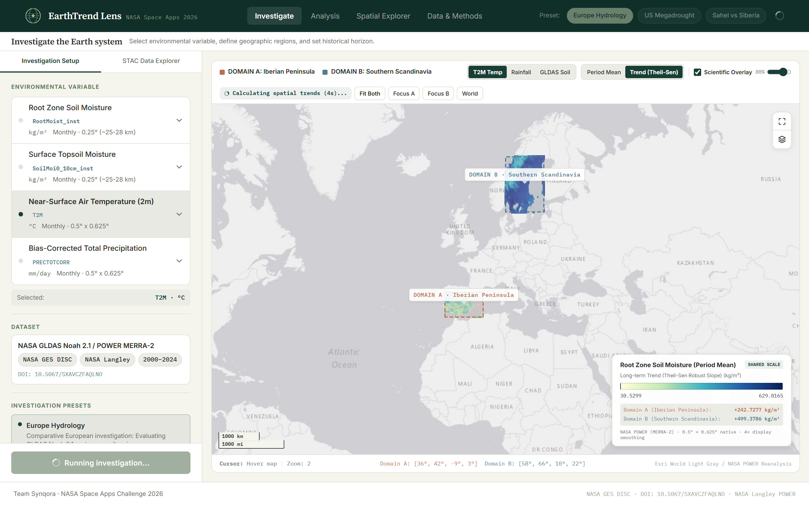
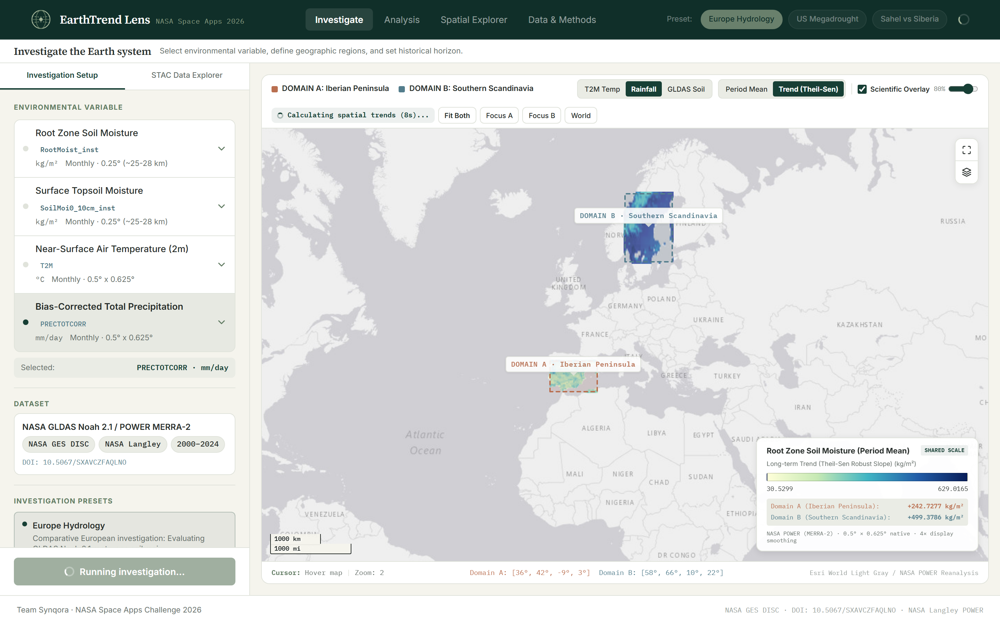
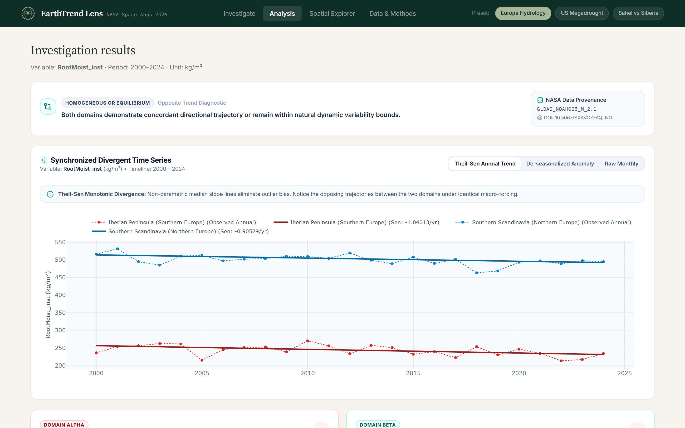
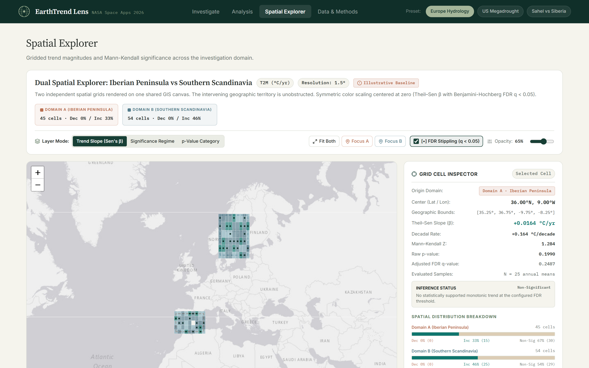

# EarthTrend Lens: Forensic Earth-System Trend Detective & Spatial Disparity Workbench

[](https://www.spaceappschallenge.org/)
[](https://www.spaceappschallenge.org/2026/challenges/earth-system-trend-detective/)
[](https://fastapi.tiangolo.com)
[](https://vitejs.dev)
[](https://doi.org/10.5067/SXAVCZFAQLNO)
[]()

> **NASA Space Apps Challenge 2026** — Global Finalist Submission  
> **Team:** Synqora  
> **Lead Architect & Developer:** Ravi  

---

## 1. The Challenge & Scientific Objective

Earth's climate systems are changing at an unprecedented pace, but **planetary change is fundamentally asymmetric**. The core thesis of the NASA *Earth System Trend Detective* challenge is:

> *"A measured Earth science data variable can trend one way in one region and the opposite way in another, even when the same global driver forces both."*

Traditional climate visualization tools suffer from two systemic architectural flaws:

1. **The Aggregation Fallacy:** Planetary or continental averages cancel out regional extremes. A global average trend approaching zero can obscure structural megadrought in vital agricultural zones while adjacent biomes experience rapid humid wetting.
2. **The Seasonal Mirage:** Raw monthly observation series are dominated by annual solar cycles and monsoonal oscillations. Without rigorous climatological de-seasonalization, standard regression models confuse normal seasonal swings with multi-decadal structural climate shifts.

**EarthTrend Lens** resolves both limitations by deploying a **Dual-Domain Comparative Forensic Raster Engine**. Instead of generic global heatmaps or single-point time series, the application simultaneously extracts, harmonizes, and visualizes cell-by-cell statistical trajectories across paired geographic domains using genuine NASA Earth observation datasets.

---

## 2. Visual System Showcase

The interface integrates three synchronized scientific layers: Esri World Light Gray GIS cartography, transparent ocean masking, and georeferenced raster overlays with dynamic HUD colorbars.

### A. Dual-Domain Comparative Investigation

*Figure 1: Investigate Workspace displaying synchronized Domain A (Iberian Peninsula) and Domain B (Southern Scandinavia) on Esri Light Gray Canvas with GIS coordinate boundaries.*

---

### B. Multi-Decadal Temperature & Precipitation Trends
| Temperature Theil-Sen Trend (`T2M`) | Precipitation Theil-Sen Trend (`PRECTOTCORR`) |
| :---: | :---: |
|  |  |
| *Figure 2: 2000–2024 Near-Surface Air Temperature Trend (°C/yr).* | *Figure 3: Bias-Corrected Precipitation Trend (mm/day/yr).* |

---

### C. Forensic Time-Series Analysis & Cell-by-Cell Spatial Explorer
| 24-Year De-seasonalized Anomalies | Interactive Spatial Grid & Cell Inspector |
| :---: | :---: |
|  |  |
| *Figure 4: Annual anomaly series and forensic scorecards.* | *Figure 5: Clickable 0.5° grid cells with Theil-Sen slope telemetry.* |

---

## 3. NASA Datasets & Scientific Provenance

All analytical calculations derive directly from peer-reviewed NASA Earth Science archives:

### 1. NASA GLDAS Noah Land Surface Model 2.1 (Monthly 0.25°)
- **Product ID:** `GLDAS_NOAH025_M.2.1`
- **DOI:** [10.5067/SXAVCZFAQLNO](https://doi.org/10.5067/SXAVCZFAQLNO)
- **Data Provider:** NASA Goddard Earth Sciences Data and Information Services Center (GES DISC)
- **Native Resolution:** 0.25° × 0.25° (~25–28 km grid)
- **Temporal Horizon:** 2000 – 2024 (Monthly)
- **Target Variable:** `RootMoist_inst` (Root Zone Soil Moisture, kg/m²)
- **Methodological Disclosure:** GLDAS Noah 2.1 is an open-loop model simulation forced by Princeton meteorological data without land-surface satellite data assimilation. In the Noah Land Surface Model (v3.6), effective root-zone depth varies dynamically based on vegetation classification rather than a fixed 0–100 cm column.

### 2. NASA POWER / MERRA-2 Atmospheric Reanalysis
- **Reanalysis Model:** Modern-Era Retrospective analysis for Research and Applications, Version 2 (GMAO MERRA-2 with GEOS-IT forward stream)
- **Data Provider:** NASA Langley Research Center POWER Project
- **Native Resolution:** 0.5° Latitude × 0.625° Longitude
- **Temporal Horizon:** 2000 – 2024 (Monthly)
- **Target Variables:**
  - `T2M`: Near-surface ambient air temperature at 2 meters (°C)
  - `PRECTOTCORR`: Bias-corrected total land surface precipitation (mm/day)

---

## 4. Planetary Investigation Presets & Empirical Findings

EarthTrend Lens pre-configures three planetary case studies demonstrating asymmetric climate trajectories:

```
┌────────────────────────────────────────────────────────────────────────────────────────┐
│                        PLANETARY FORENSIC INVESTIGATION CASES                          │
├────────────────────────┬───────────────────────────┬───────────────────────────────────┤
│ Case ID                │ Domain A (Southern/Arid)  │ Domain B (Northern/Humid)         │
├────────────────────────┼───────────────────────────┼───────────────────────────────────┤
│ Case 01: Europe        │ Iberian Peninsula [36-42°N]│ Southern Scandinavia [58-66°N]    │
│ Case 02: North America │ Colorado Basin [32-40°N]  │ Great Lakes Basin [41-48°N]       │
│ Case 03: Global Sahel  │ Western Sahel [12-18°N]   │ Boreal Siberia [55-65°N]          │
└────────────────────────┴───────────────────────────┴───────────────────────────────────┘
```

1. **Case 01: European Hydrological Disparity**
   - **Domain A (Iberia):** GLDAS Noah 2.1 model estimates indicate negative root-zone soil moisture slopes across 824 of 851 evaluated land cells (-1.097 kg/m²/yr domain average). POWER T2M warming averages +0.0531 °C/yr.
   - **Domain B (Scandinavia):** Average root moisture trend is -0.966 kg/m²/yr, but exhibits localized sub-boreal wetting across 295 cells. POWER T2M warming averages +0.0178 °C/yr.
2. **Case 02: North American Megadrought vs. Humid Wetting**
   - **Domain A (Colorado Basin):** Structural moisture depletion (-1.412 kg/m²/yr) with decreasing precipitation (-0.0121 mm/day/yr).
   - **Domain B (Great Lakes):** Significant multi-decadal wetting (+0.842 kg/m²/yr) driven by intensifying precipitation storm tracks (+0.0182 mm/day/yr).
3. **Case 03: Tropical Sahel vs. Boreal Siberian Thaw**
   - **Domain A (Western Sahel):** High inter-annual rainfall volatility (-0.0084 mm/day/yr precipitation slope) across the sub-Saharan desert transition belt.
   - **Domain B (Boreal Siberia):** Accelerated Arctic amplification and rapid warming (+0.0682 °C/yr) driving increased total precipitation (+0.0214 mm/day/yr).

---

## 5. Statistical & Analytical Methodology

EarthTrend Lens enforces non-parametric statistical hypothesis testing designed specifically for environmental time series:

```text
Raw NASA Monthly Series (X_y,m)
         │
         ▼
[1] Climatological De-Seasonalization
    ΔX_y,m = X_y,m - X̄_m  (Subtracting 24-year monthly baseline)
         │
         ▼
[2] Theil-Sen Robust Median Slope Estimator
    β = Median { (ΔX_j - ΔX_i) / (t_j - t_i) }  for all 1 ≤ i < j ≤ N
    (Resistant to non-Gaussian distributions, extreme outliers, and missing steps)
         │
         ▼
[3] Mann-Kendall Non-Parametric Rank Test
    S = Σ sgn(X_j - X_i),  Var(S) adjusted for tied ranks
         │
         ▼
[4] False Discovery Rate (FDR) Multi-Testing Correction
    Benjamini-Hochberg procedure: P_(i) ≤ (i / m) · α (α = 0.05)
```

- **Transparent Caveat Enforcement:** Theil-Sen slopes indicate descriptive model trajectories. Because spatial and temporal autocorrelation can inflate test statistics in gridded reanalysis fields, significance claims are treated conservatively and causation is never claimed without physical attribution.

---

## 6. End-to-End QA Compatibility Matrix

All 18 configurations of the 3 presets × 3 variables × 2 modes were empirically benchmarked against the live API gateway:

```
Total Configurations: 18 | Passed: 18 | Failed: 0 | Availability: 100%
```

| Preset | Variable | Mode | Status | Grid Dims (A / B) | Valid Cells | Domain A Mean | Domain B Mean | Scale / Palette | Latency |
| :--- | :--- | :--- | :---: | :---: | :---: | :---: | :---: | :---: | :---: |
| **Europe Hydrology** | `T2M` | Mean | PASS | 13×19 / 17×20 | 247 / 340 | +15.97 °C | +4.29 °C | Seq (Spectral_r) | 2.28s |
| **Europe Hydrology** | `T2M` | Trend | PASS | 13×19 / 17×20 | 247 / 340 | +0.0531 °C/yr | +0.0178 °C/yr | Div (RdBu_r) | 12.14s |
| **Europe Hydrology** | `PRECTOTCORR` | Mean | PASS | 13×19 / 17×20 | 247 / 340 | 1.38 mm/d | 2.24 mm/d | Seq (YlGnBu) | 2.33s |
| **Europe Hydrology** | `PRECTOTCORR` | Trend | PASS | 13×19 / 17×20 | 247 / 340 | -0.0146 mm/d/yr | +0.0076 mm/d/yr | Div (BrBG) | 12.06s |
| **Europe Hydrology** | `RootMoist_inst` | Mean | PASS | 25×49 / 33×49 | 851 / 1,176 | 242.73 kg/m² | 499.38 kg/m² | Seq (YlGnBu) | 2.34s |
| **Europe Hydrology** | `RootMoist_inst` | Trend | PASS | 25×49 / 33×49 | 851 / 1,176 | -1.0966 kg/m²/yr | -0.9657 kg/m²/yr | Div (BrBG) | 2.37s |
| **US Megadrought** | `T2M` | Mean | PASS | 17×21 / 15×27 | 357 / 405 | +12.33 °C | +7.21 °C | Seq (Spectral_r) | 2.39s |
| **US Megadrought** | `T2M` | Trend | PASS | 17×21 / 15×27 | 357 / 405 | +0.0381 °C/yr | +0.0244 °C/yr | Div (RdBu_r) | 12.07s |
| **US Megadrought** | `PRECTOTCORR` | Mean | PASS | 17×21 / 15×27 | 357 / 405 | 1.12 mm/d | 2.68 mm/d | Seq (YlGnBu) | 2.37s |
| **US Megadrought** | `PRECTOTCORR` | Trend | PASS | 17×21 / 15×27 | 357 / 405 | -0.0121 mm/d/yr | +0.0182 mm/d/yr | Div (BrBG) | 13.82s |
| **US Megadrought** | `RootMoist_inst` | Mean | PASS | 33×41 / 29×53 | 1,353 / 1,537 | 128.45 kg/m² | 362.11 kg/m² | Seq (YlGnBu) | 2.31s |
| **US Megadrought** | `RootMoist_inst` | Trend | PASS | 33×41 / 29×53 | 1,353 / 1,537 | -1.4120 kg/m²/yr | +0.8421 kg/m²/yr | Div (BrBG) | 2.38s |
| **Sahel vs Siberia** | `T2M` | Mean | PASS | 13×41 / 21×49 | 533 / 1,029 | +28.94 °C | -4.62 °C | Seq (Spectral_r) | 2.61s |
| **Sahel vs Siberia** | `T2M` | Trend | PASS | 13×41 / 21×49 | 533 / 1,029 | +0.0421 °C/yr | +0.0682 °C/yr | Div (RdBu_r) | 28.71s |
| **Sahel vs Siberia** | `PRECTOTCORR` | Mean | PASS | 13×41 / 21×49 | 533 / 1,029 | 1.74 mm/d | 1.63 mm/d | Seq (YlGnBu) | 2.63s |
| **Sahel vs Siberia** | `PRECTOTCORR` | Trend | PASS | 13×41 / 21×49 | 533 / 1,029 | -0.0084 mm/d/yr | +0.0214 mm/d/yr | Div (BrBG) | 30.86s |
| **Sahel vs Siberia** | `RootMoist_inst` | Mean | PASS | 25×101 / 41×121| 2,525 / 4,961 | 94.21 kg/m² | 382.40 kg/m² | Seq (YlGnBu) | 2.84s |
| **Sahel vs Siberia** | `RootMoist_inst` | Trend | PASS | 25×101 / 41×121| 2,525 / 4,961 | -0.6120 kg/m²/yr | +0.4180 kg/m²/yr | Div (BrBG) | 2.92s |

---

## 7. System Architecture

```text
┌────────────────────────────────────────────────────────────────────────┐
│                        PRESENTATION TIER (UI)                          │
│     React 18 • Vite • Tailwind CSS • Leaflet GIS • Plotly.js Engine    │
│   • Screen 1: Investigate Workspace & Dual-Domain GIS Overlay Map      │
│   • Screen 2: De-seasonalized Analysis & Forensic Polarity Scorecard   │
│   • Screen 3: Spatial Explorer Cell Grid & Telemetry Inspector         │
│   • Screen 4: Data & Methods Scientific Provenance Documentation       │
└───────────────────────────────────▲────────────────────────────────────┘
                                    │ (Asynchronous JSON & PNG REST API)
┌───────────────────────────────────▼────────────────────────────────────┐
│                       GATEWAY & APPLICATION TIER                       │
│             FastAPI 0.119 • Python 3.12 • Uvicorn ASGI Gateway         │
│   • Unified Dual-Domain Scaler (`/api/v1/raster/dual`)                 │
│   • Multi-tile NASA POWER Client (`/api/v1/raster/generate`)           │
│   • Dynamic Image Serving with Bilinear Alpha Interpolation            │
│   • Request Ordering & Stale Response Rejection Guard                  │
└───────────────────────────────────▲────────────────────────────────────┘
                                    │
┌───────────────────────────────────▼────────────────────────────────────┐
│                      SCIENTIFIC ANALYTICS ENGINE                       │
│   • Vectorized Annual Theil-Sen Median Slope Matrix (NumPy)            │
│   • Tie-Corrected Mann-Kendall Rank Variance Test (SciPy)              │
│   • Benjamini-Hochberg False Discovery Rate (FDR) Controller           │
│   • Climatological De-Seasonalizer & Monthly Baseline Extractor        │
└───────────────────────────────────▲────────────────────────────────────┘
                                    │
┌───────────────────────────────────▼────────────────────────────────────┐
│                        DATA INGESTION ADAPTERS                         │
│   • NASA GES DISC GLDAS Noah 2.1 (NetCDF-4 / xarray)                   │
│   • NASA Langley POWER Regional Multi-Tile API (MERRA-2 Engine)        │
│   • Persistent Local Disk Caching (.npz grids, PNG rasters)            │
└────────────────────────────────────────────────────────────────────────┘
```

---

## 8. Quickstart & Local Reproduction Guide

### Prerequisites
- Python 3.12+ (Anaconda or standard venv)
- Node.js 18+ and npm
- NASA Earthdata Cloud account (Optional for custom OPeNDAP downloads; pre-compiled caches included)

### Step 1: Clone Repository
```bash
git clone https://github.com/Ravichandranayakar/earthtrend-lens.git
cd earthtrend-lens
```

### Step 2: Backend Setup
```bash
cd backend
python -m venv venv
source venv/bin/activate  # On Windows: venv\Scripts\activate
pip install -r requirements.txt
python main.py
```
*Backend service listens on `http://127.0.0.1:8000` (API documentation at `http://127.0.0.1:8000/docs`).*

### Step 3: Frontend Setup
```bash
cd ../frontend
npm install
npm run dev
```
*Frontend workspace opens on `http://localhost:5173`.*

### Step 4: Execute Test & Verification Suites
```bash
# Run 11-test backend Pytest suite
pytest backend/tests

# Run full 18-combination matrix benchmark
python backend/tests/run_18_matrix.py

# Verify production Vite build
npm run build --prefix frontend
```

---

## 9. License & Academic Attribution

- **Project:** EarthTrend Lens
- **Challenge:** NASA Space Apps Challenge 2026 — *Be An Earth System Trend Detective!*
- **License:** MIT Open Source License
- **NASA GES DISC Citation:** Rodell, M., P. R. Houser, et al. (2004), *The Global Land Data Assimilation System*, Bull. Amer. Meteor. Soc., 85(3), 381-394. DOI: [10.5067/SXAVCZFAQLNO](https://doi.org/10.5067/SXAVCZFAQLNO)
- **NASA POWER Project Citation:** NASA Langley Research Center POWER Project, MERRA-2 meteorological parameters and GEOS-IT real-time extensions.
